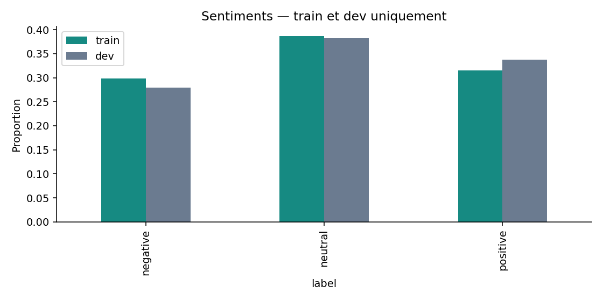
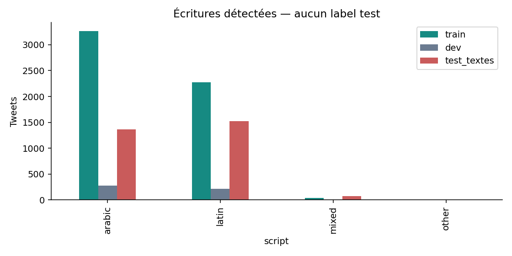
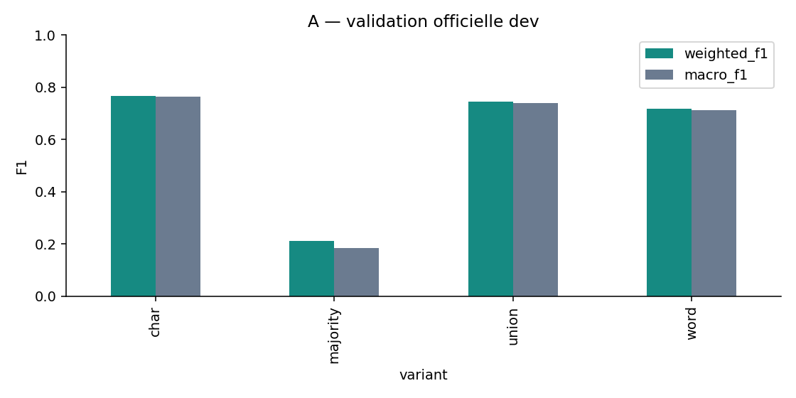
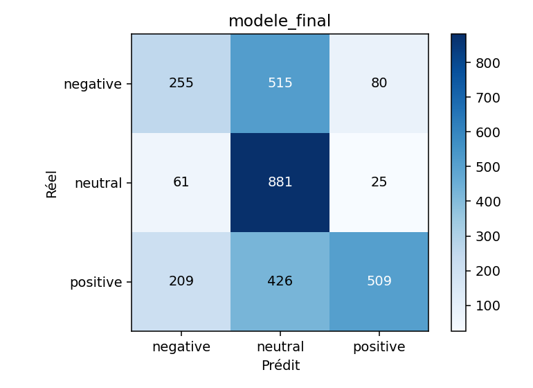
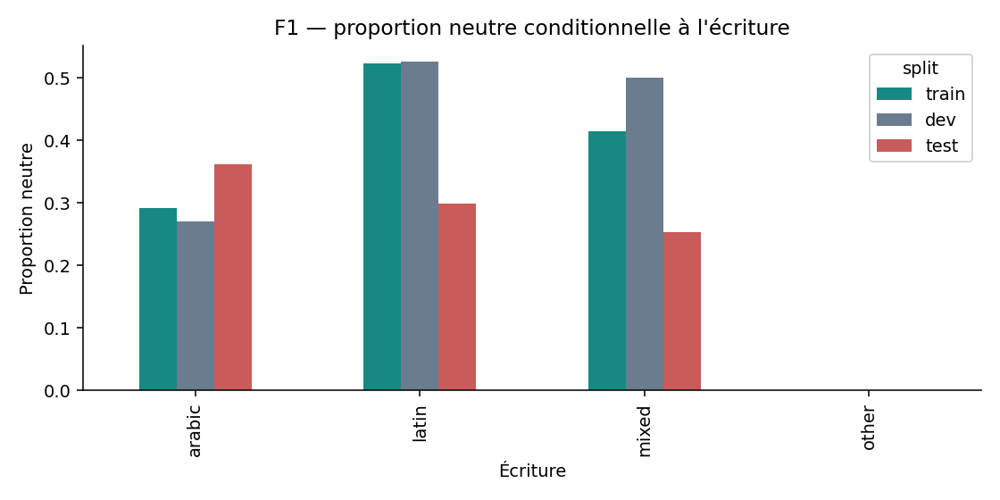

# Darija-Sentiment : plan de soutenance avec les questions officielles

Statut : plan et affectation des figures acceptés. Le style ivoire/vert et le générateur intégré sont confirmés. L’utilisateur a autorisé la réalisation complète sans autres validations intermédiaires. Voir approvals.json.

Public : professeur et étudiants de Master Big Data. Langue : français avec exemples arabes et Arabizi. 24 diapositives en 16:9, dont une annexe. Durée cible : environ 20 à 25 minutes, selon le niveau de détail oral. Les explications développées figurent dans les notes prévues, avec une idée et trois points principaux par diapositive.

## Méthodologie orale

1. Poser le problème : reconnaître trois sentiments malgré les graphies variables.
2. Établir la fiabilité : expliquer les partitions officielles, le nettoyage et les raccourcis.
3. Comparer les méthodes : partir de TF-IDF, puis expliquer ce qu'ajoute chaque modèle.
4. Lire les résultats : nommer la mesure, la partition et la population avant de commenter le graphique.
5. Expliquer les limites : distinguer observation, hypothèse et expérience non exécutée.
6. Proposer un choix pratique : qualité, généralisation, coût et suivi après déploiement.

Répartition indicative : contexte et données 4 minutes, méthodes 7 minutes, sélection et résultats 4 minutes, robustesse et démonstration 4 minutes, conclusion 1 minute. L'annexe ne fait pas partie du parcours minuté.

Les réponses officielles apparaîtront au moment où leur preuve est présentée. Une mention Qn discrète permettra au jury de les retrouver sans transformer les diapositives en questionnaire. Les énoncés sont conservés dans `../../research/questions_officielles.md`. Le contenu préparatoire chiffré figure dans `answers.draft.md`, les valeurs sources et diagnostics dans `evidence.draft.json`.

## Règles scientifiques

- Périmètre maintenu : ary uniquement. Q9 reçoit une réponse théorique et un état « expérience exclue du périmètre », sans réintroduire arq.
- Q8 : campagne E complète non exécutée. Aucun gain D/E ou DarijaBERT/Arabizi inventé.
- Q3 : F4 mesure une perturbation conjointe emojis/ponctuation, pas des ablations individuelles du français, des chiffres et des lettres répétées.
- Q7 : cinq exemples d'attention décrivent des cas, pas une concentration générale démontrée sur des catégories linguistiques.
- Q10 : l'oracle est le meilleur point rétrospectif de 25 réglages. Il ne remplace jamais la décision choisie sur dev.
- Q11 : le contrôle même architecture modifie à la fois taille et couverture de train. L'écart reste descriptif.
- Q12 : désaccord entre annotateurs et taux réel de labels faux sont distincts. Les 30 erreurs ne forment pas un échantillon aléatoire représentatif de toutes les erreurs.

## Plan détaillé

### Slide 1 : Analyse de sentiment en darija marocaine
- Rôle : couverture.
- Points : trois sentiments ; écritures arabe, latine et mixte ; Groupe 12, Master Big Data, ary uniquement.
- Visuel : illustration linguistique originale. Pas de nom d'étudiant ni de prédiction inventés.
- Oral : annoncer la question expérimentale en 20 secondes.

### Slide 2 : Une langue, plusieurs graphies
- Rôle : motivation.
- Points : orthographe variable ; chiffres Arabizi et français ; négations, emojis et ironie.
- Visuel : trois courts exemples illustratifs, explicitement distincts d'exemples mesurés.
- Transition : la qualité du protocole doit précéder la sophistication des modèles.

### Slide 3 : Train apprend, val choisit, test mesure
- Rôle : protocole.
- Points : partitions 5 583 / 494 / 2 961 ; transformations apprises sur train ; sélection et checkpoints verrouillés avant test.
- Visuel : processus expérimental et frontière entre validation et évaluation finale.
- Questions : Q1, Q2, Q10.
- Sources : manifeste des données, `results/selection_lock.json`.

### Slide 4 : Distributions et classifieur majoritaire
- Rôle : données et référence triviale.
- Points : distributions globales train/val/test ; majorité train neutre conservée partout ; Weighted-F1 principal et Macro-F1 complémentaire.
- Chiffres : majorité Weighted-F1 train 0,2160, val 0,2117, test 0,1608. Distinguer ces F1 des accuracy.
- Visuel : figure train/dev existante, complétée par la distribution test et les trois F1 issus du dossier de preuves. Le test correspond à l'analyse après verrouillage.
- Image requise stricte : préserver axes, valeurs, légendes, couleurs et barres.
  
- Question : Q1.

### Slide 5 : Le raccourci d'écriture
- Rôle : relation écriture/sentiment.
- Points : distributions par alphabet ; règle apprise sur train arabe=positif et latin=neutre ; score script-only val 0,3656 et test 0,2945.
- Visuel : figure d'effectifs des écritures et comparaison des proportions neutres, clairement séparées des effectifs. Détail des trois labels par écriture dans les notes.
- Image requise stricte :
  
- Conclusion : corrélations de corpus à contrôler, sans invalider automatiquement tous les scores.
- Questions : Q1, Q2.

### Slide 6 : Prétraitement et perte d'indices
- Rôle : choix par famille et ablation disponible.
- Points : nettoyage conservateur ; TF-IDF mots/caractères, tokens regex et tokenizers PLM ; limite de l'ablation conjointe F4.
- Chiffres : A 9/102 bascules, B 11/89, C 24/107, D 39/134 sur leurs cas initialement corrects et modifiés.
- Visuel : avant/après illustratif et tableau mesuré. Pas de classement causal entre ces sous-populations.
- Limite : suppression du français, chiffres Arabizi et lettres répétées non évaluée séparément.
- Question : Q3.

### Slide 7 : A — TF-IDF et régression logistique
- Rôle : méthode simple et preuve dev.
- Points : mots 1–2 ; caractères 2–5 ; combinaison et régression équilibrée.
- Chiffres : mots dev 0,7189, caractères 0,7683, valeurs moyennes enregistrées.
- Image requise stricte :
  
- Oral : expliquer pourquoi des fragments de caractères peuvent partager des informations entre graphies.

### Slide 8 : B1 — NLI et formulations des hypothèses
- Rôle : principe zero-shot et sensibilité.
- Points : prémisse=tweet, hypothèse=sentiment ; interactions entre les tokens de la paire ; résultats bruts distincts du réglage val.
- Tableau val : arabe 0,3980 / 0,5010 ; français 0,3980 / 0,4972 ; anglais 0,3860 / 0,4634, respectivement argmax / décalages val.
- Visuel : mécanisme de la paire et tableau des scores. Pas de score test NLI inventé.
- Limite : une formulation par langue, effet de langue et paraphrase non isolés.
- Question : Q4.
- Sources théoriques : fiche officielle NLI, Yin et al. (2019), He et al. (DeBERTa).

### Slide 9 : B2 — CAMeLBERT selon l'écriture
- Rôle : transfert spécialisé et contamination.
- Points : test arabe 0,5581 ; test latin 0,1442 ; écart de couverture plausible, non isolé causalement.
- Visuel : comparaison arabe/latin, avec n=1 367 et n=1 519.
- Limite : supervision sentiment externe sur ASTD, ArSAS et SemEval. Absence de contamination non certifiée.
- Question : Q5.

### Slide 10 : Déséquilibre et décision multiclasse
- Rôle : ablation contrôlée.
- Points : pondération, suréchantillonnage train et décalages ; séparation train/val avant rééchantillonnage ; gains de réglage val à interpréter sur leur partition de sélection.
- Tableau val argmax / réglé : référence 0,7223 / 0,7370 ; pondérée 0,7273 / 0,7356 ; oversampling 0,7241 / 0,7294.
- Visuel : tableau comparatif et règle argmax(log(p)+b).
- Question : Q6.

### Slide 11 : C — Embeddings, BiLSTM et attention
- Rôle : architecture et représentation.
- Points : hasard, AraVec et fastText train ; BiLSTM bidirectionnel ; attention et padding masqué, vocabulaire fermé aux OOV.
- Visuel : architecture et exemple réel ary:dev:3, avec tala3 environ 0,451 et niveau environ 0,181.
- Limite : une attention visible sur un terme français ne prouve pas une préférence générale. Noms propres et ponctuation peuvent aussi dominer.
- Question : Q7.
- Source numérique : `results/attention_C_5_examples.csv`.

### Slide 12 : C1, C2, C3 et C4 — résultats et positions
- Rôle : comparaison des réseaux.
- Points : tableau par initialisation ; attention non systématiquement meilleure ; positions utiles dans deux initialisations, pas dans toutes.
- Chiffres random dev : BiLSTM 0,7385, attention 0,7370, Transformer 0,7068, Character-CNN 0,6983. Détail fastText et AraVec dans les notes et le dossier de réponses.
- Visuel : comparaison principale et trois paires sans/avec positions. Ne pas généraliser l'effet random aux autres initialisations.
- Question : Q7.

### Slide 13 : D et E — ce qui apprend et ce qui reste à mesurer
- Rôle : gelé / fine-tuning et coût.
- Points : D apprend la tête ; E ajusterait aussi l'encodeur ; comparaison standard/Arabizi non conclue.
- Chiffres D : test 0,5321, 435 715 paramètres entraînables, 88,21 ms/tweet ; temps tête 52,34 s plus extraction partagée 486,77 s.
- Visuel : schéma gelé/ajustable et état des expériences. E standard environ 146,9 millions de paramètres, sans F1 complet.
- Limite : les pas techniques E sur deux exemples ne mesurent pas le coût d'une campagne complète.
- Question : Q8.

### Slide 14 : Multi-tâche et poids λ — discussion théorique
- Rôle : réponse explicite à l'exigence hors périmètre.
- Points : perte théorique L_ary+λ L_arq ; bénéfice possible d'un partage pertinent ; risque de transfert négatif.
- Visuel : concept de partage de paramètres, étiqueté « théorie, expérience exclue du périmètre ary ».
- État : effet de λ et gain arq non mesurés. Aucun corpus arq réintroduit, aucun graphique de gain fictif.
- Question : Q9.
- Source : Ruder (2017).

### Slide 15 : Sélection scientifique avant le test
- Rôle : synthèse du choix.
- Points : moyenne dev sur trois graines sauf B fixe ; A caractères retenu ; représentant graine 42 prédéfini.
- Chiffres dev A 0,7683, B 0,6023, C 0,7476, D 0,7509.
- Visuel : classement dev et verrouillage. E non mesuré.
- Questions : Q1, Q12.

### Slide 16 : Comparaison sur le test officiel
- Rôle : résultat global.
- Points : représentants A 0,5365, B 0,4209, C 0,4962, D 0,5321 ; Macro-F1 complémentaire ; E non mesuré.
- Visuel : graphique de comparaison avec partition, mesure et graine explicites, puis coût CPU résumé.
- Limite : ne pas confondre les scores des représentants et les moyennes entre graines.
- Question : Q12.
- Source : `results/comparison.csv`.

### Slide 17 : Matrice de confusion du candidat
- Rôle : apprendre à lire les erreurs par classe.
- Points : diagonale ; confusions ; score global et comportement par classe.
- Image requise stricte :
  
- Questions : Q1, Q12.

### Slide 18 : Décalage de distribution et oracle rétrospectif
- Rôle : diagnostic après verrouillage.
- Points : prior global val/test ; changement conditionnel au latin ; écart entre décision val et meilleur point de la grille sur test.
- Chiffres : test règle val 0,5365, argmax brut 0,5536, oracle grille 0,5738. Écart descriptif 3,72 points, non déployé.
- Image requise stricte :
  
- Production proposée : suivi des écritures et prédictions, annotations récentes, recalibration validée sur de nouvelles données réservées.
- Limite : pas d'optimum continu garanti ni preuve d'un pur label shift.
- Question : Q10.

### Slide 19 : Écriture non vue — chute mesurée
- Rôle : transfert entre écritures au sein de ary.
- Points : test arabe union train complet 0,7481 contre train latin 0,1932 ; test latin union train complet 0,3461 contre train arabe 0,2098 ; couverture des deux écritures nécessaire.
- Visuel : deux comparaisons sur les mêmes populations et la même architecture.
- Limite : témoin complet rétrospectif ; taille de train et couverture d'écriture changent ensemble. Aucune modification du candidat.
- Question : Q11.

### Slide 20 : Robustesse et incertitude
- Rôle : préciser les limites d'une comparaison.
- Points : 1 000 bootstrap et IC 95 % ; variabilité des graines ; McNemar A/D p=0,3231 sur les taux d'erreur, pas sur le F1.
- Visuel : tableau exact des scores et intervalles test A/B/C/D, sans approximation de géométrie. Le taux OOV reste dans le dossier de réponses.
- Limite : bootstrap conditionnel au checkpoint et F4 conditionnel aux succès initiaux.
- Questions : Q11, Q12.

### Slide 21 : Trente erreurs et bruit d'annotation
- Rôle : revue qualitative.
- Points : 8 bruit possible, 8 neutre/polarisé, 7 ironie/autre et 7 graphies Arabizi possibles ; votes retrouvés pour 18 cas dont 8 désaccords ; taux de labels faux inconnu.
- Visuel : catégories et deux véritables exemples avec label, prédiction et hypothèse prudente.
- Limite : échantillonnage équilibré entre catégories, non représentatif de toutes les erreurs ; validation humaine à faire.
- Question : Q12.

### Slide 22 : Tester et expliquer avec l'application
- Rôle : démonstration.
- Points : six espaces ; modèles locaux chargés séquentiellement ; comparaisons, historique, exports et règle de décision.
- Visuel : schéma fonctionnel de l'application. Une illustration générée ne sera pas présentée comme une capture réelle.
- Oral : démonstration optionnelle de 45 secondes préparée à l'avance. Une phrase réussie ne mesure pas le F1.

### Slide 23 : Choix pratique et limites du déploiement
- Rôle : conclusion et recommandation conditionnelle.
- Points : A caractères candidat retenu, 0,5365 test, 3,62 ms/tweet et 5,39 Mo ; faiblesse latin à valider sur le domaine cible ; E et revue humaine restent à compléter.
- Visuel : synthèse qualité / coût / limites, suivie des prochaines expériences explicitement non exécutées.
- Recommandation : prototype accompagné de monitoring et de nouvelles annotations, sans garantie de fiabilité pour tous les commentaires mixtes.
- Questions : Q8, Q11, Q12.

### Slide 24 : Références et index Q1–Q12 — annexe
- Rôle : retrouver une réponse pendant les échanges.
- Points : index officiel des questions, statut des preuves et références primaires.
- Visuel : bibliographie courte et index compact. Chaque diapositive dispose aussi de ses sources dans les notes prévues.

## Couverture des questions officielles

| Question | Diapositives | État de la réponse |
|---|---|---|
| Q1 | 3, 4, 5, 15, 17 | Distributions et majorité chiffrées, métriques expliquées |
| Q2 | 5 | Règle script-only chiffrée, limites de validité explicitées |
| Q3 | 6 | Prétraitements détaillés, F4 disponible, ablations individuelles manquantes |
| Q4 | 8 | Trois formulations linguistiques sur val, brutes et ajustées, principe NLI |
| Q5 | 9 | Scores par écriture et contamination non exclue |
| Q6 | 10 | Tableau contrôlé, décalages et frontière train/val |
| Q7 | 11, 12 | Architectures et positions chiffrées, attention descriptive sur cinq cas |
| Q8 | 13, 23 | D mesuré, E incomplet, aucun gain ni vainqueur Arabizi inventé |
| Q9 | 14 | Théorie de λ, expérience exclue par le périmètre ary |
| Q10 | 18 | Distributions, diagnostic grille-test et suivi proposé |
| Q11 | 19, 20, 23 | Chutes descriptives et choix conditionnel pour les deux écritures |
| Q12 | 16, 17, 20, 21, 23 | Erreurs, désaccords, coûts et proposition de prototype |

## Affectation des cinq figures existantes

| Diapositive | Fichier existant | Rôle |
|---|---|---|
| 4 | `results/figures/labels_train_dev.png` | Distribution train/dev, avec chiffres test séparés |
| 5 | `results/figures/scripts.png` | Effectifs des écritures, avec distributions conditionnelles séparées |
| 7 | `results/figures/A_dev.png` | Variantes A sur dev |
| 17 | `results/figures/modele_final.png` | Matrice du candidat final |
| 18 | `results/figures/F1_conditional_shift.png` | Distribution conditionnelle des labels |

Ces figures sont des entrées strictes : préserver leurs données, axes, labels, couleurs et légendes. Les autres graphiques prévus représenteront uniquement les chiffres documentés des CSV et du dossier de preuves. Les schémas conceptuels ne seront pas présentés comme des résultats expérimentaux.

## Format et étapes suivantes

Le workflow codex-ppt demandé produit des images complètes de diapositives, assemblées dans un PPTX 16:9. Les textes et graphiques ne seront donc pas séparément éditables. Les notes de présentation en français seront intégrées au PPT et livrées dans `speech.md` après les validations requises.

Étape active : production. Génération d’une diapositive de référence, contrôle interne sous l’autorisation reçue, production des autres pages par sous-agents, puis notes et assemblage. Aucune autre validation utilisateur n’est attendue.
